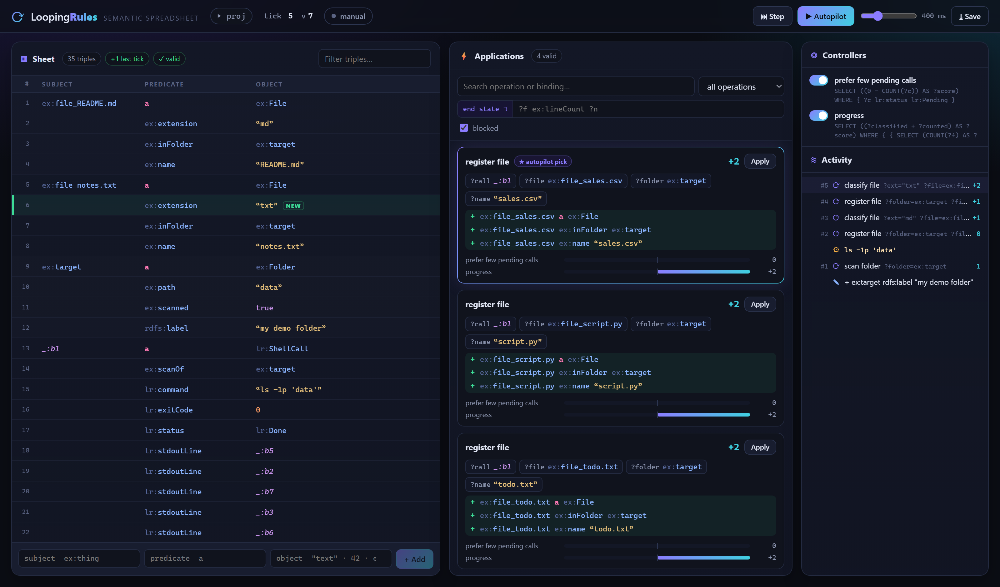

# 🔁 LoopingRules

**A semantic spreadsheet. You describe the moves; the engine plays them.**

LoopingRules replaces rows and columns with **RDF triples** and replaces hand-written workflows with **rules**. You declare:
- what a valid world looks like,
- which moves are possible,
- which outcomes you prefer.

Then you either drive the computation one step at a time, or put it on **autopilot** and watch it loop until there's nothing left to do.



*Above: the `folder-scan` example in mid-run. On the left is the **sheet**, where the triples the last tick changed glow green. In the middle are the **applications** that could fire next: each one shows its delta and how every controller scores the state it would produce, and the autopilot's pick is outlined. On the right are the **controllers** you can switch on and off, and the **activity** log.*

The example lists the files in a folder with `ls`, registers and classifies each one, and counts the lines of the `.txt` files with `wc`. There is no workflow script: it's 5 rules, a few SHACL shapes and 2 scoring queries.

---

## Why?

A workflow describes **one path**. Every new case needs a new script, and the meaning of the data gets lost in the glue code.

LoopingRules turns this around. The state is a knowledge graph with explicit semantics. The rules are small, local and reusable, and the engine works out which ones apply right now. New situations need new rules, not a rewrite.

## How it works

| Concept | What it is | Written in |
|---|---|---|
| **Sheet** | The current state: a set of triples. | RDF (Turtle) |
| **Model** | What a valid state is, plus the available operations. | SHACL + SPARQL |
| **Operation** | A precondition plus a delta, i.e. which triples it deletes and which it inserts. | SPARQL `WHERE` / `DELETE` / `INSERT` |
| **Application** | One concrete match of an operation against the sheet. | — |
| **Controller** | A query that **scores the state an application would produce**. | SPARQL `SELECT ?score` |
| **Tool** | A way to act on the outside world: the sheet requests a call, the engine runs it, the result becomes triples. | RDF |

**One tick:**

1. 🔍 **Enumerate.** Every binding of every operation's `WHERE` is a candidate application.
2. 🧪 **Simulate.** For each candidate, compute the state it would produce.
3. 🛡️ **Guard.** Drop candidates whose result breaks the SHACL shapes.
4. 📊 **Score.** Every active controller scores every resulting state, and the scores are summed.
5. ▶️ **Apply.** In manual mode you choose; on autopilot the highest score wins.
6. 🔧 **Tools.** Between ticks, the shell commands requested in the sheet are approved, run, and their output is written back as triples.

Autopilot keeps going until no operation is applicable, or until you stop it.

### An operation

```turtle
ex:classifyFile a lr:Operation ;
  rdfs:label "classify file" ;
  lr:where """
    ?file a ex:File ; ex:name ?name .
    FILTER(CONTAINS(?name, "."))
    FILTER NOT EXISTS { ?file ex:extension ?any }
    BIND(LCASE(REPLACE(?name, "^.*[.]", "")) AS ?ext)
  """ ;
  lr:insert "?file ex:extension ?ext ." .
```

### A controller

```turtle
ex:preferFewPendingCalls a lr:Controller ;
  lr:query "SELECT ((0 - COUNT(?c)) AS ?score) WHERE { ?c lr:status lr:Pending }" .
```

### Calling the shell, from the data itself

```turtle
_:call a lr:ShellCall ; lr:command "wc -l < 'notes.txt'" ; lr:status lr:Pending .
#   ... approved, executed between ticks, and it becomes ...
_:call lr:status lr:Done ; lr:exitCode 0 ;
       lr:stdoutLine [ lr:index 0 ; lr:text "42" ] .
```

## Share models, not code

Models and controllers are **pure data**: RDF, SPARQL and SHACL. Sharing one carries none of the risks of sharing a script. The only way a model can touch the outside world is through tool calls, and **every tool call needs approval**. Autopilot pauses until you decide:


## Your shapes are your autocomplete

The SHACL shapes that guard the state also **guide your editing**:
- **Predicates.** Type a subject and you get the properties its shapes allow. Required ones come first, with their `sh:description`; full ones are struck through.
- **Objects.** These come from `sh:in`, from existing instances of `sh:class`, or from `sh:datatype`. Your input is checked against the datatype and `sh:pattern` before it's sent.
- **"Still needs".** A strip lists the properties the subject is still missing. Click one to fill it in.


## Quick start

```bash
# 1. the engine
cd engine
python -m venv .venv
.venv/Scripts/pip install -e ".[dev]"     # on Linux/macOS: .venv/bin/pip

# 2. the web UI
cd ../ui
npm install
npm run build

# 3. serve a project and open http://127.0.0.1:8765
cd ..
engine/.venv/Scripts/lr serve examples/folder-scan
```

For UI development, run `npm run dev` in `ui/` (port 5173) while `lr serve` is running. Vite proxies the API to it.

### Headless

```bash
# list what could happen right now
engine/.venv/Scripts/lr apps examples/folder-scan

# put it on autopilot (it asks before every shell command)
engine/.venv/Scripts/lr run examples/folder-scan
```


| Option | Effect |
|---|---|
| `--yes` | approve every call automatically |
| `--max-ticks N` | stop after N ticks |
| `--save` | write the resulting sheet back to the project |
| `--svg out.svg` | export the console output as an SVG |

To scan a different folder, edit `ex:path` in `examples/folder-scan/sheet.ttl`. On Windows, shell calls go through Git Bash. You can override this with the `LR_SHELL` environment variable.

Run the tests with:

```bash
.venv/Scripts/python -m pytest
```

## Architecture

```
engine/   Python: rdflib + pySHACL engine, FastAPI server, `lr` CLI
ui/       TypeScript: React + Vite, talks to the engine over /api and a WebSocket
examples/ ready-to-run projects
```

## A project is just a folder

```
my-project/
  sheet.ttl         # the state
  model.ttl         # SHACL shapes + lr:Operations
  controllers.ttl   # lr:Controllers
```

## Roadmap

- [x] Engine core: operations, SHACL guard, scoring controllers, autopilot
- [x] Shell tool with per-call approval, and the headless CLI
- [x] HTTP + WebSocket API
- [x] Spreadsheet-style web UI: edit triples, filter applications (including by a SPARQL pattern on the end state), preview deltas, approve calls
- [x] Autocomplete for editing, derived from the SHACL shapes
- [ ] Named graphs (full SPOG quads)
- [ ] An allowlist for approving tool calls automatically
- [ ] Controllers learned from your manual choices (anti-unification, RIPPER)
- [ ] Layered controllers: freeze what works, and add new ones that beat it in specific situations

The design notes are in [`doc/design.md`](doc/design.md), the original vision in [`doc/info.md`](doc/info.md), and the current plan in [`doc/plan-v0.md`](doc/plan-v0.md).

## License

MIT © Antonio Castaldo D'Ursi
