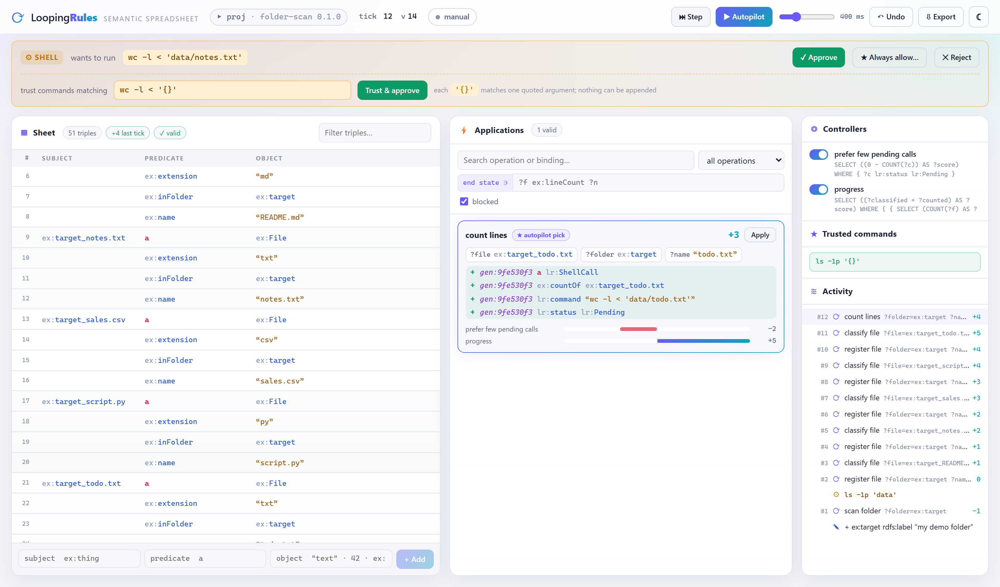
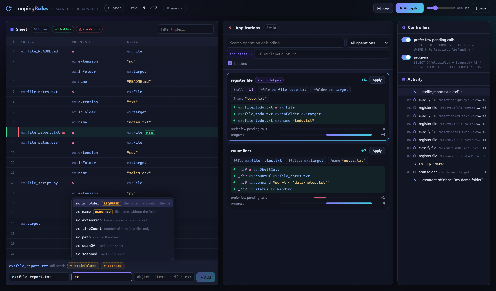
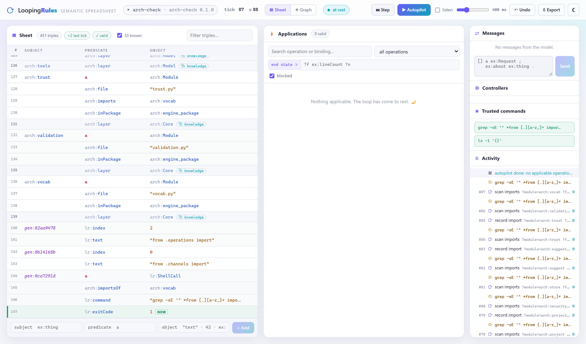
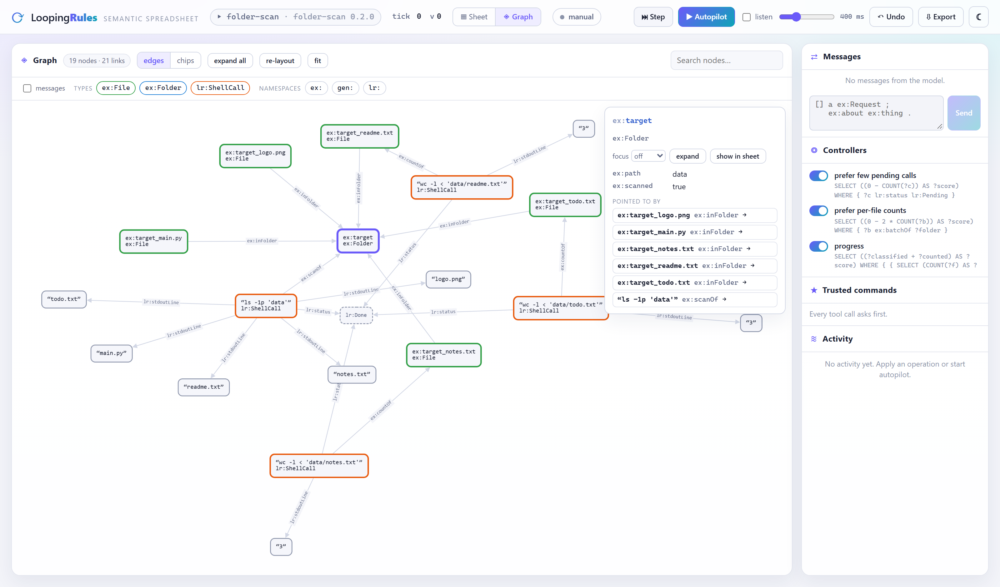
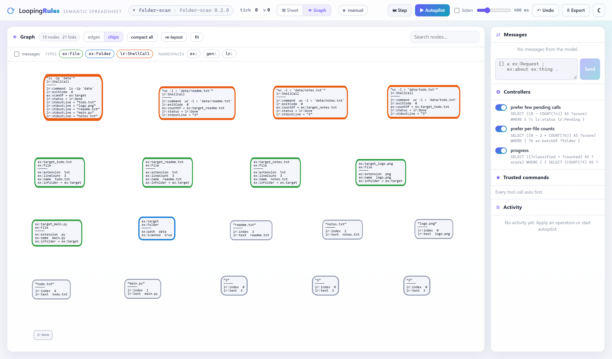
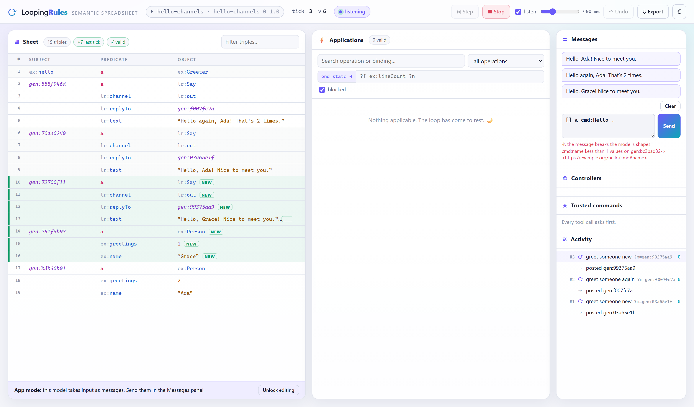
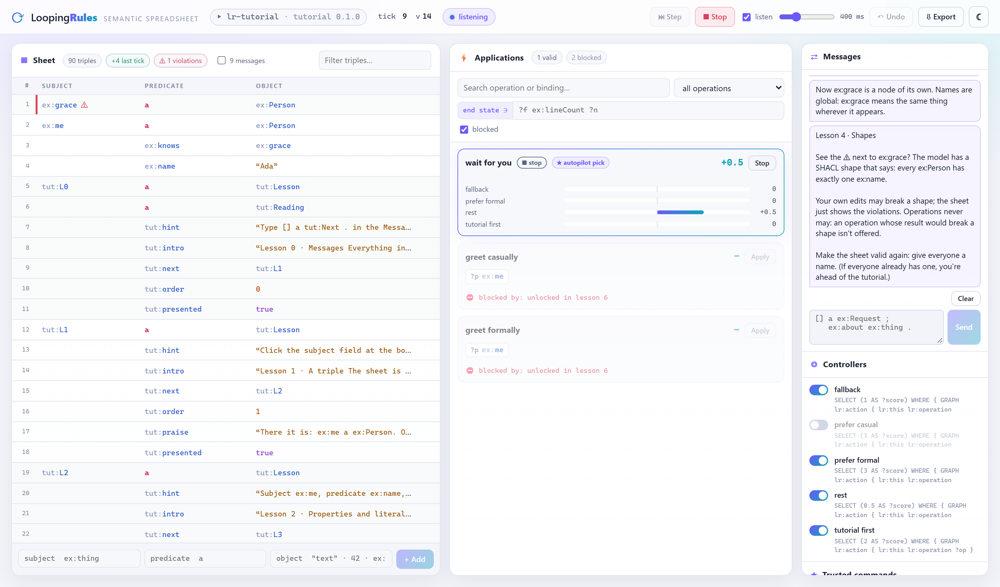
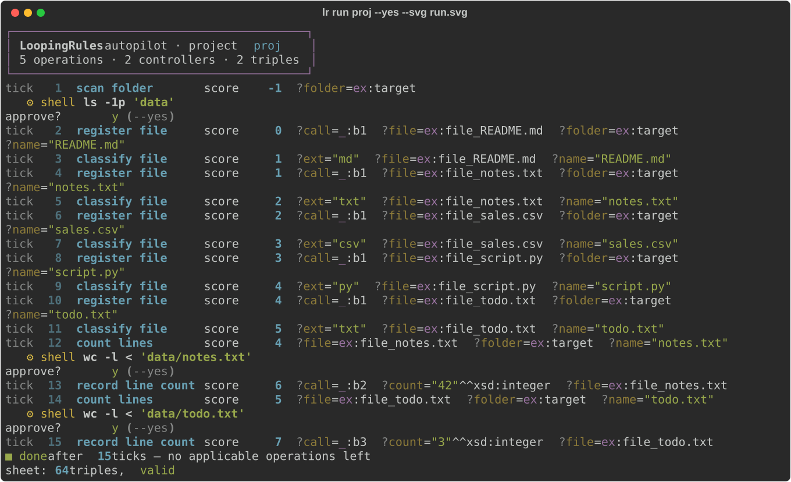

# 🔁 LoopingRules

**A semantic spreadsheet. You describe the moves; the engine plays them.**

LoopingRules replaces rows and columns with **RDF triples** and replaces hand-written workflows with **rules**. You declare:
- what a valid world looks like,
- which moves are possible,
- which outcomes you prefer.

Then you either drive the computation one step at a time, or put it on **autopilot** and watch it loop until there's nothing left to do.


*Above: the `folder-scan` example in mid-run. On the left is the **sheet**, where the triples the last tick changed glow green. In the middle are the **applications** that could fire next: each one shows its delta and how every controller scores the state it would produce, and the autopilot's pick is outlined. On the right are the **controllers** you can switch on and off, and the **activity** log.*

The example lists the files in a folder with `ls`, registers and classifies each one, and counts the lines of the `.txt` files with `wc`. There is no workflow script: it's 5 rules, a few SHACL shapes and 2 scoring queries.

> **New here?** Run `lr tutorial`. It's an interactive tutorial that is itself a LoopingRules model ([more below](#learn-by-doing-the-tutorial)).

---

## Why?

A workflow describes **one path**. Every new case needs a new script, and the meaning of the data gets lost in the glue code.

LoopingRules turns this around. The state is a knowledge graph with explicit semantics. The rules are small, local and reusable, and the engine works out which ones apply right now. New situations need new rules, not a rewrite.

## How it works

| Concept | What it is | Written in |
|---|---|---|
| **Sheet** | The current state: a set of triples. | RDF (Turtle) |
| **Model** | What a valid state is, plus the available operations. | SHACL + SPARQL |
| **Operation** | A precondition plus a delta, i.e. which triples it deletes and which it inserts. | SPARQL `WHERE` / `DELETE` / `INSERT` |
| **Application** | One concrete match of an operation against the sheet. | — |
| **Controller** | A query that **scores an application**: the state it would produce, or the change itself. | SPARQL `SELECT ?score` |
| **Tool** | A way to act on the outside world: the sheet requests a call, the engine runs it, the result becomes triples. | RDF |

**One tick:**

1. 🔍 **Enumerate.** Every binding of every operation's `WHERE` is a candidate application.
2. 🧪 **Simulate.** For each candidate, compute the state it would produce.
3. 🛡️ **Guard.** Drop candidates whose result breaks the SHACL shapes.
4. 📊 **Score.** Every active controller scores every candidate, and the scores are summed (each times its `lr:weight`, default 1).
5. ▶️ **Apply.** In manual mode you choose; on autopilot the highest score wins.
6. 🔧 **Tools.** Between ticks, the shell commands requested in the sheet are approved, run, and their output is written back as triples.

Autopilot keeps going until no operation is applicable, until a **stop** wins, or until you stop it. A stop is just an operation with no effects; controllers score it like anything else, and it has to strictly beat every other application to win:

```turtle
ex:stop a lr:Operation ; rdfs:label "stop" ; lr:where "" .   # always available

ex:enoughIsEnough a lr:Controller ;
  lr:query """SELECT (10 AS ?score) WHERE {
                GRAPH lr:action { lr:this lr:operation ex:stop }
                GRAPH lr:before { ?goal lr:reached true } }""" .
```

### An operation

```turtle
ex:classifyFile a lr:Operation ;
  rdfs:label "classify file" ;
  lr:where """
    ?file a ex:File ; ex:name ?name .
    FILTER(CONTAINS(?name, "."))
    FILTER NOT EXISTS { ?file ex:extension ?any }
    BIND(LCASE(REPLACE(?name, "^.*[.]", "")) AS ?ext)
  """ ;
  lr:insert "?file ex:extension ?ext ." .
```

Operations can also declare which variables identify an action, named guards, postconditions, and several ordered steps:

```turtle
ex:forgetFolder a lr:Operation ;
  lr:params "folder" ;                     # one application per folder, not per file
  lr:where  "?folder a ex:Folder ; ex:scanned true ." ;
  lr:requires [ rdfs:label "no scan in progress" ;
                lr:ask "FILTER NOT EXISTS { ?c ex:scanOf ?folder ; lr:status lr:Pending }" ] ;
  lr:steps (
    [ lr:where "?f ex:inFolder ?folder ; ?p ?o ." ; lr:delete "?f ?p ?o ." ]   # every file of the folder
    [ lr:delete "?folder ex:scanned true ." ]
  ) .
```

A blocked application is still listed, with the reason ("blocked by: no scan in progress"). Operation patterns use a subset of SPARQL (no subqueries, aggregates, `MINUS`, property paths or `GRAPH`), so that matching can become incremental later.

### A controller

```turtle
ex:preferFewPendingCalls a lr:Controller ;
  lr:query "SELECT ((0 - COUNT(?c)) AS ?score) WHERE { ?c lr:status lr:Pending }" .
```

A controller's default graph is the state the application would produce. It can also look at the application itself through named graphs:

| Graph | Contents |
|---|---|
| `GRAPH lr:before` | the sheet as it is now |
| `GRAPH lr:inserted`, `GRAPH lr:deleted` | the change |
| `GRAPH lr:action` | `lr:this lr:operation <op> ; lr:binds [ lr:var "file" ; lr:value <node> ]` |

A controller that only reads the change stays cheap however big the sheet grows:

```turtle
ex:rewardCounts a lr:Controller ;
  lr:weight 2 ;
  lr:query "SELECT (COUNT(?f) AS ?score) WHERE { GRAPH lr:inserted { ?f ex:lineCount ?n } }" .
```

### Calling the shell, from the data itself

```turtle
_:call a lr:ShellCall ; lr:command "wc -l < 'notes.txt'" ; lr:status lr:Pending .
#   ... approved, executed between ticks, and it becomes ...
_:call lr:status lr:Done ; lr:exitCode 0 ;
       lr:stdoutLine [ lr:index 0 ; lr:text "42" ] .
```

## Goal-driven, without a goal engine

Goals are just data plus a few authoring habits:
- **A goal is a resource in the sheet**, e.g. `ex:g1 a ex:CountLinesGoal ; ex:folder ex:target`.
- **Operations require an unreached goal**, so nothing happens until you state what you want.
- **An authored "goal reached" operation** sets `lr:reached true` when the goal's condition holds.
- **Controllers reward reaching the goal**, so autopilot marks it as soon as it can, and then stops, because nothing is applicable any more.
- **Subgoals** are operations that insert more goals.

```turtle
ex:countLinesReached a lr:Operation ;
  lr:where """
    ?goal a ex:CountLinesGoal ; ex:folder ?folder .
    FILTER NOT EXISTS { ?goal lr:reached true }
    ?call ex:scanOf ?folder ; lr:status lr:Done .          # scanned (else: vacuously true!)
    FILTER NOT EXISTS { ?t ex:inFolder ?folder ; ex:extension "txt" .
                        FILTER NOT EXISTS { ?t ex:lineCount ?c } }
    ...
  """ ;
  lr:insert "?goal lr:reached true ." .
```

See [`examples/folder-scan-goal`](examples/folder-scan-goal). Add a goal in the UI (autocomplete knows the goal's shape) and press ▶ Autopilot.

## Share models, not code

Models and controllers are **pure data**: RDF, SPARQL and SHACL. Sharing one carries none of the risks of sharing a script. The only way a model can touch the outside world is through tool calls, and **every tool call needs approval**. Autopilot pauses until you decide.



**Trusted commands** let autopilot run unattended. Click *Always allow…* and LoopingRules proposes a template such as `wc -l < '{}'`:
- each `'{}'` matches exactly one single-quoted argument;
- an argument cannot contain quotes or newlines;
- nothing can be appended to the command.

So `wc -l < 'x'; rm -rf /` never matches. Trust belongs to **you**, not to the project: rules are stored in `~/.loopingrules/trust.ttl` (or `$LR_TRUST`), scoped to the project's path. A shared project can't bring its own approvals. The headless `lr run` honours the same rules.

## Your shapes are your autocomplete

The SHACL shapes that guard the state also **guide your editing**:
- **Predicates.** Type a subject and you get the properties its shapes allow. Required ones come first, with their `sh:description`; full ones are struck through.
- **Objects.** These come from `sh:in`, from existing instances of `sh:class`, or from `sh:datatype`. Your input is checked against the datatype and `sh:pattern` before it's sent.
- **"Still needs".** A strip lists the properties the subject is still missing. Click one to fill it in.



## Nothing is lost, everything can be undone

Every change is **saved automatically** in an append-only journal, `.lr/history.rdfp`: each tick, edit and tool result is one transaction in RDF Patch style (`A`/`D` lines).
- **Restart** the server and you continue exactly where you were.
- **↶ Undo** reverts the latest change, also across restarts. It does this by appending the inverse change, so the journal itself is never rewritten.
- **Your files are never rewritten.** `sheet.ttl`, `model.ttl` and `controllers.ttl` are what you wrote, comments included; `sheet.ttl` is just the starting point. Delete `.lr/` to start over.
- **Minted names, not blank nodes.** Things the engine creates get stable names like `gen:3f2a9c1e`, so the journal can always refer to them.

## Packs: share complete features, as plain triples

**Everything is SPO.** Operations, shapes and controllers are already RDF, so a project or a **pack** is just a set of Turtle files, and file names don't matter. The engine sorts the triples by convention:
- a subject `a lr:Operation`, `a lr:Controller`, or a shape (`sh:NodeShape`, `sh:targetClass`, …) is a definition, together with the blank nodes it uses;
- `a lr:Package` is the manifest;
- **everything else is knowledge:** read-only facts that sit beside the sheet. Operations, controllers and shapes can see them, but nothing can change them, and they're never journaled.

A **pack** declares what it extends, and can carry anything except state: new operations, shapes, controllers, knowledge. It's a complete feature you can share. Packs stack on the base project, and can also extend other packs.

```turtle
<urn:lr:package> a lr:Package ;
  dcterms:title "big-folders" ; lr:version "0.1.0" ;
  lr:extends "folder-scan" .
```

```bash
lr import exports/folder-scan-0.2.0.lr.zip my-scan
lr add-layer exports/big-folders-0.1.0.lr.zip my-scan    # → my-scan/layers/big-folders/
```

`lr add-layer` refuses a pack that doesn't fit:
- one that extends something not installed;
- one that redefines an operation, shape or controller already defined;
- one that binds a prefix to a different namespace.

A pack's declared commands are trusted only with `--trust-declared`. To remove a pack, delete its folder under `layers/`.

**The example: steering.** The base model, [`folder-scan`](examples/folder-scan), offers two ways to count lines: one `wc` call per file, or a single batch `wc -l 'folder'/*.txt`. The pack [`big-folders`](examples/big-folders) adds one controller: *"if a folder has more than N files, prefer the batch"*. With 7 files, autopilot makes **one** batch call; with 3, nothing changes.


Knowledge rows show up in the sheet marked with their source (`⧉ knowledge`, or the pack's name), and can't be edited. An operation that would delete knowledge is invalid. Names are global, so knowledge and state describe the same resources: below, `arch:validation`'s layer comes from `knowledge.ttl`, and its file and imports come from the run.



## Check your code with rules: `lr check`

`lr check` runs a project to rest, starting fresh from its seed and writing nothing, then reports. It's made for CI, pre-commit and coding-agent hooks:

| Exit | Meaning |
|---|---|
| 0 | passed |
| 1 | failed: SHACL violations in the final state, or **findings** (`lr:out` messages of type `lr:Finding`) |
| 2 | incomplete: a command that isn't trusted, the tick limit reached, or a project that doesn't load |

[`arch-check`](examples/arch-check) is LoopingRules checking LoopingRules:
- **Architecture:** its layering is knowledge. There are five ranked layers, from core to front, and each module has a layer.
- **Facts:** two declared commands, `ls` and `grep`, collect each module's imports.
- **Findings:** rules report any import from a higher layer, and any module without a layer.

```bash
$ lr check examples/arch-check --trust-declared
lr check examples/arch-check: ✓ passed (87 ticks)
```

**As a pre-commit hook** (`.pre-commit-config.yaml`):

```yaml
repos:
  - repo: local
    hooks:
      - id: arch-check
        name: architecture check (LoopingRules)
        entry: lr check examples/arch-check --trust-declared --quiet
        language: system
        pass_filenames: false
        files: ^engine/loopingrules/.*[.]py$
```

**As a Claude Code hook** (`.claude/settings.json`). Exit code 2 sends the report back to the agent, so it fixes the layering before it stops:

```json
{ "hooks": { "Stop": [ { "hooks": [ { "type": "command",
  "command": "lr check examples/arch-check --trust-declared --quiet --stderr || exit 2" } ] } ] } }
```

`--json` gives machine-readable output. See design D29.

## See it as a graph

The **◈ Graph** tab shows the same triples as a graph, live, built with [Cytoscape.js](https://js.cytoscape.org/).

- **Nodes are resources.** Literals stay inside their subject's card, and `rdf:type` is shown as the node's colour, so the picture doesn't turn into a hairball.
- **Links are ordinary triples** whose object is another resource. Show them as **edges**, or as **chips** inside each card for large sheets.
- **Navigate:**
  - pan, zoom, and fit;
  - double-click a node to **expand** it with all its properties;
  - search, and hide types, namespaces or messages;
  - **focus** on a node's neighbourhood within N hops.
- **The details panel** lists a node's properties, its links and what points to it, with each link clickable. *Show in sheet* jumps to its rows.
- **It stays live:** changed nodes glow, and nodes with SHACL violations get a red border.





## Talk to a running model: `lr:in` and `lr:out`

Humans and tools send **messages** to a model, and the model answers with messages. A message is just a resource on a channel. There is no new engine concept, only a convention:

```turtle
# you post this to lr:in ...
[] a cmd:Hello ; cmd:name "Ada" .

# ... an operation consumes it and answers on lr:out
gen:7b7e31e6 lr:channel lr:out ; a lr:Say ;
  lr:text "Hello, Ada! Nice to meet you." ; lr:replyTo gen:5cf580d1 .
```

- **A message asks; it doesn't edit.** A post may only describe its own new nodes, so it can't change the state directly. The model's operations decide what happens.
- **Commands are checked by your shapes.** A post that breaks them is refused, with the violations.
- **Listening.** With *listen* on, autopilot doesn't stop when nothing is left to do: it waits for the next message.
- **App mode.** A package can declare `lr:directEdits false`. The sheet becomes read-only, and input goes through the Messages panel. You can still unlock editing for a session.



The same works headless, as a pipe: messages in on stdin, answers out on stdout, all as Turtle.

```bash
printf '[] a cmd:Hello ; cmd:name "Ada" .\n' | lr run examples/hello-channels --listen
```

See [`hello-channels`](examples/hello-channels) and design D25. The sheet hides message triples by default, since they appear in the Messages panel; a checkbox in the sheet header shows them.

## Learn by doing: the tutorial

```bash
lr tutorial            # copies it to ./lr-tutorial and serves it on http://127.0.0.1:8765
```

Tick **listen**, press **▶ Autopilot**, and follow the messages. Nine short lessons teach you to *think in SPOs*:
1. messages;
2. a triple;
3. properties and literals;
4. links;
5. shapes;
6. operations (you apply one by hand);
7. controllers (you switch them and watch autopilot change course);
8. commands;
9. a wrap-up.

You do the exercises in the sheet, and talk to the tutorial in the Messages panel: `[] a tut:Hint .`, `[] a tut:Skip .`, `[] a tut:Next .`.



**The tutorial is itself a LoopingRules model**, with no special engine support:
- lessons and your progress are triples in the sheet;
- operations present each lesson, answer messages, and check each exercise with a pattern;
- the operations of the learner's world are unlocked lesson by lesson by guards (`lr:requires`);
- a no-op *wait* lets autopilot rest until you act;
- controllers decide that the tutorial answers first, and that autopilot waits instead of applying "introduce" for you.

Read [`examples/tutorial`](examples/tutorial) once you've finished: it's the best example of how a model is put together. It's also tested end to end (`engine/tests/test_tutorial.py`). Design: D26.

## Share models, controllers and examples


**Export** from the UI menu, or with `lr export my-project`. You get a single `.lr.zip` containing:

| File | |
|---|---|
| `package.ttl` | the manifest: title, version, description, author, license, and **`lr:mayRun`**: every command the model may ask to run |
| `*.ttl` | definitions and knowledge: usually `model.ttl`, `controllers.ttl`, `knowledge.ttl` |
| `sheet.ttl` | optional: your example seed sheet, the current state, or nothing |
| `README.md` | optional |

Your journal and your trusted commands are **never** exported.

**Import** with `lr import some-model.lr.zip my-copy`. LoopingRules shows the manifest and the commands the model may run. Nothing is trusted unless you pass `--trust-declared`. If a model ever asks to run a command its manifest didn't declare, the approval banner flags it.

Importing is defensive:
- only the files listed above are accepted, with size limits;
- everything must parse;
- **queries that could reach the network (`SERVICE`, `FROM`) are refused**, so a shared model cannot leak your data.

👉 **Try it:** download one of the [example exports](exports/) and import it.

A minimal manifest:

```turtle
@prefix lr: <https://loopingrules.org/ns#> .
@prefix dcterms: <http://purl.org/dc/terms/> .

<urn:lr:package> a lr:Package ;
  dcterms:title "folder-scan" ; lr:version "0.1.0" ;
  dcterms:description "Lists a folder and counts the lines of its .txt files." ;
  dcterms:creator "Your Name" ; dcterms:license "MIT" ;
  lr:mayRun "ls -1p '{}'" , "wc -l < '{}'" .
```

## Quick start

```bash
# 1. the engine
cd engine
python -m venv .venv
.venv/Scripts/pip install -e ".[dev]"     # on Linux/macOS: .venv/bin/pip
.venv/Scripts/pip install -e ".[fast]"    # optional: native pattern matching, several times faster
                                          # (Windows Smart App Control: pip install pyoxigraph==0.5.0)

# 2. the web UI
cd ../ui
npm install
npm run build

# 3. serve a project and open http://127.0.0.1:8765
cd ..
engine/.venv/Scripts/lr serve examples/folder-scan

# or start with the tutorial
engine/.venv/Scripts/lr tutorial
```

The UI starts in a light theme. The ☾ button switches to dark, and the choice is remembered.

For UI development, run `npm run dev` in `ui/` (port 5173) while `lr serve` is running. Vite proxies the API to it.

### Headless

```bash
# list what could happen right now
engine/.venv/Scripts/lr apps examples/folder-scan

# put it on autopilot (it asks before every shell command)
engine/.venv/Scripts/lr run examples/folder-scan
```



### Sharing from the command line

```bash
engine/.venv/Scripts/lr export examples/folder-scan            # → folder-scan-0.1.0.lr.zip
engine/.venv/Scripts/lr export examples/folder-scan --sheet none
engine/.venv/Scripts/lr import exports/folder-scan-0.2.0.lr.zip my-copy [--trust-declared]
engine/.venv/Scripts/lr add-layer exports/big-folders-0.1.0.lr.zip my-copy
```

| Option | Effect |
|---|---|
| `--yes` | approve every call automatically |
| `--max-ticks N` | stop after N ticks |
| `--save` | also write a snapshot (every change is journaled anyway) |
| `--svg out.svg` | export the console output as an SVG |

To scan a different folder, edit `ex:path` in `examples/folder-scan/sheet.ttl`. On Windows, shell calls go through Git Bash. You can override this with the `LR_SHELL` environment variable.

Run the tests with:

```bash
.venv/Scripts/python -m pytest
```

## Architecture

```
engine/   Python: rdflib + pySHACL engine, FastAPI server, `lr` CLI
ui/       TypeScript: React + Vite, talks to the engine over /api and a WebSocket
examples/ ready-to-run projects
```

## A project is just a folder

```
my-project/
  sheet.ttl         # the seed state (yours, never rewritten)
  model.ttl         # SHACL shapes + lr:Operations      ┐ any *.ttl: sorted by type,
  controllers.ttl   # lr:Controllers                    │ so names are just habits
  knowledge.ttl     # read-only facts                   │
  package.ttl       # optional manifest, for sharing    ┘
  README.md         # optional
  layers/<pack>/    # packs added with lr add-layer: any *.ttl but a sheet
  .lr/              # runtime state: journal + snapshot (delete to reset)
```

## Roadmap

- [x] Engine core: operations, SHACL guard, scoring controllers, autopilot
- [x] Shell tool with per-call approval, and the headless CLI
- [x] HTTP + WebSocket API
- [x] Spreadsheet-style web UI: edit triples, filter applications (including by a SPARQL pattern on the end state), preview deltas, approve calls
- [x] Autocomplete for editing, derived from the SHACL shapes
- [x] Goal-driven computation as a modeling pattern (no engine changes)
- [x] Automatic persistence with an append-only journal, and undo
- [x] Sharing through `.lr.zip` exports with a manifest of declared commands
- [x] Packs that carry complete features (operations, shapes, controllers, knowledge) as plain triples
- [x] Performance, step 1: each SPARQL query parsed once (7–10× faster)
- [x] Performance, step 2: lazy validation and overlays
- [ ] Performance: incremental matching, incremental SHACL (see [`doc/handoff.md`](doc/handoff.md))
- [x] Input/output channels (`lr:in`/`lr:out`), listening autopilot, app mode
- [x] An interactive tutorial, written as a model (`lr tutorial`)
- [x] A graph view of the sheet (pan, zoom, filter, expand/compact, edges or chips)
- [ ] An MCP server, so coding agents can use LoopingRules as a tool
- [x] `lr check` for CI, pre-commit and agent hooks; `arch-check` checks this repository
- [ ] Named graphs (full SPOG quads): deferred, see D24
- [x] An allowlist for approving tool calls automatically
- [ ] Controllers learned from your manual choices (anti-unification, RIPPER)

The design notes are in [`doc/design.md`](doc/design.md), the original vision in [`doc/info.md`](doc/info.md), and the current plan in [`doc/plan-v0.md`](doc/plan-v0.md).

## License

MIT © Antonio Castaldo D'Ursi
