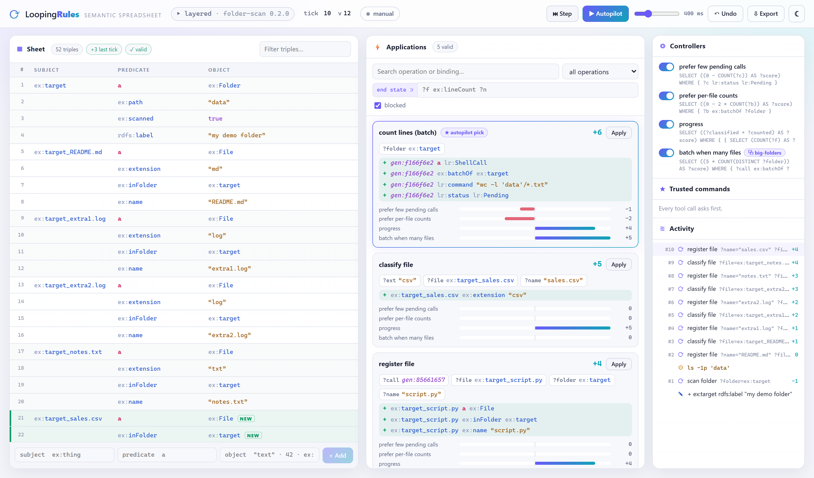
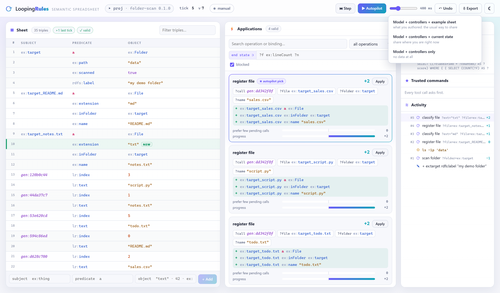

# 🔁 LoopingRules

**A semantic spreadsheet. You describe the moves; the engine plays them.**

LoopingRules replaces rows and columns with **RDF triples** and replaces hand-written workflows with **rules**. You declare:
- what a valid world looks like,
- which moves are possible,
- which outcomes you prefer.

Then you either drive the computation one step at a time, or put it on **autopilot** and watch it loop until there's nothing left to do.


*Above: the `folder-scan` example in mid-run. On the left is the **sheet**, where the triples the last tick changed glow green. In the middle are the **applications** that could fire next: each one shows its delta and how every controller scores the state it would produce, and the autopilot's pick is outlined. On the right are the **controllers** you can switch on and off, and the **activity** log.*

The example lists the files in a folder with `ls`, registers and classifies each one, and counts the lines of the `.txt` files with `wc`. There is no workflow script: it's 5 rules, a few SHACL shapes and 2 scoring queries.

---

## Why?

A workflow describes **one path**. Every new case needs a new script, and the meaning of the data gets lost in the glue code.

LoopingRules turns this around. The state is a knowledge graph with explicit semantics. The rules are small, local and reusable, and the engine works out which ones apply right now. New situations need new rules, not a rewrite.

## How it works

| Concept | What it is | Written in |
|---|---|---|
| **Sheet** | The current state: a set of triples. | RDF (Turtle) |
| **Model** | What a valid state is, plus the available operations. | SHACL + SPARQL |
| **Operation** | A precondition plus a delta, i.e. which triples it deletes and which it inserts. | SPARQL `WHERE` / `DELETE` / `INSERT` |
| **Application** | One concrete match of an operation against the sheet. | — |
| **Controller** | A query that **scores the state an application would produce**. | SPARQL `SELECT ?score` |
| **Tool** | A way to act on the outside world: the sheet requests a call, the engine runs it, the result becomes triples. | RDF |

**One tick:**

1. 🔍 **Enumerate.** Every binding of every operation's `WHERE` is a candidate application.
2. 🧪 **Simulate.** For each candidate, compute the state it would produce.
3. 🛡️ **Guard.** Drop candidates whose result breaks the SHACL shapes.
4. 📊 **Score.** Every active controller scores every resulting state, and the scores are summed.
5. ▶️ **Apply.** In manual mode you choose; on autopilot the highest score wins.
6. 🔧 **Tools.** Between ticks, the shell commands requested in the sheet are approved, run, and their output is written back as triples.

Autopilot keeps going until no operation is applicable, or until you stop it.

### An operation

```turtle
ex:classifyFile a lr:Operation ;
  rdfs:label "classify file" ;
  lr:where """
    ?file a ex:File ; ex:name ?name .
    FILTER(CONTAINS(?name, "."))
    FILTER NOT EXISTS { ?file ex:extension ?any }
    BIND(LCASE(REPLACE(?name, "^.*[.]", "")) AS ?ext)
  """ ;
  lr:insert "?file ex:extension ?ext ." .
```

### A controller

```turtle
ex:preferFewPendingCalls a lr:Controller ;
  lr:query "SELECT ((0 - COUNT(?c)) AS ?score) WHERE { ?c lr:status lr:Pending }" .
```

### Calling the shell, from the data itself

```turtle
_:call a lr:ShellCall ; lr:command "wc -l < 'notes.txt'" ; lr:status lr:Pending .
#   ... approved, executed between ticks, and it becomes ...
_:call lr:status lr:Done ; lr:exitCode 0 ;
       lr:stdoutLine [ lr:index 0 ; lr:text "42" ] .
```

## Goal-driven, without a goal engine

Goals are just data plus a few authoring habits:
- **A goal is a resource in the sheet**, e.g. `ex:g1 a ex:CountLinesGoal ; ex:folder ex:target`.
- **Operations require an unreached goal**, so nothing happens until you state what you want.
- **An authored "goal reached" operation** sets `lr:reached true` when the goal's condition holds.
- **Controllers reward reaching the goal**, so autopilot marks it as soon as it can, and then stops, because nothing is applicable any more.
- **Subgoals** are operations that insert more goals.

```turtle
ex:countLinesReached a lr:Operation ;
  lr:where """
    ?goal a ex:CountLinesGoal ; ex:folder ?folder .
    FILTER NOT EXISTS { ?goal lr:reached true }
    ?call ex:scanOf ?folder ; lr:status lr:Done .          # scanned (else: vacuously true!)
    FILTER NOT EXISTS { ?t ex:inFolder ?folder ; ex:extension "txt" .
                        FILTER NOT EXISTS { ?t ex:lineCount ?c } }
    ...
  """ ;
  lr:insert "?goal lr:reached true ." .
```

See [`examples/folder-scan-goal`](examples/folder-scan-goal). Add a goal in the UI (autocomplete knows the goal's shape) and press ▶ Autopilot.

## Share models, not code

Models and controllers are **pure data**: RDF, SPARQL and SHACL. Sharing one carries none of the risks of sharing a script. The only way a model can touch the outside world is through tool calls, and **every tool call needs approval**. Autopilot pauses until you decide.


**Trusted commands** let autopilot run unattended. Click *Always allow…* and LoopingRules proposes a template such as `wc -l < '{}'`:
- each `'{}'` matches exactly one single-quoted argument;
- an argument cannot contain quotes or newlines;
- nothing can be appended to the command.

So `wc -l < 'x'; rm -rf /` never matches. Trust belongs to **you**, not to the project: rules are stored in `~/.loopingrules/trust.ttl` (or `$LR_TRUST`), scoped to the project's path. A shared project can't bring its own approvals. The headless `lr run` honours the same rules.

## Your shapes are your autocomplete

The SHACL shapes that guard the state also **guide your editing**:
- **Predicates.** Type a subject and you get the properties its shapes allow. Required ones come first, with their `sh:description`; full ones are struck through.
- **Objects.** These come from `sh:in`, from existing instances of `sh:class`, or from `sh:datatype`. Your input is checked against the datatype and `sh:pattern` before it's sent.
- **"Still needs".** A strip lists the properties the subject is still missing. Click one to fill it in.


## Nothing is lost, everything can be undone

Every change is **saved automatically** in an append-only journal, `.lr/history.rdfp`: each tick, edit and tool result is one transaction in RDF Patch style (`A`/`D` lines).
- **Restart** the server and you continue exactly where you were.
- **↶ Undo** reverts the latest change, also across restarts. It does this by appending the inverse change, so the journal itself is never rewritten.
- **Your files are never rewritten.** `sheet.ttl`, `model.ttl` and `controllers.ttl` are what you wrote, comments included; `sheet.ttl` is just the starting point. Delete `.lr/` to start over.
- **Minted names, not blank nodes.** Things the engine creates get stable names like `gen:3f2a9c1e`, so the journal can always refer to them.

## Controller packs: change the trajectory, not the model

A **controller pack** contains only controllers. It can't add operations or data; it can only **steer** the choices a model already offers. Packs stack on top of a base model, and their scores are summed with the model's own controllers. These are the *layered controllers* from the original idea.

The examples show how it works:
- **The base model, [`folder-scan`](examples/folder-scan),** offers two ways to count lines: one `wc` call per file, or a single batch `wc -l 'folder'/*.txt`. Its own controllers prefer one call per file.
- **The pack, [`big-folders`](examples/big-folders),** holds one controller that says *"if a folder has more than N files, prefer the batch"*. N is data in the sheet (`ex:settings ex:batchThreshold 10`, default 4), not code in the pack.



```bash
lr import exports/folder-scan-0.2.0.lr.zip my-scan
lr add-layer exports/big-folders-0.1.0.lr.zip my-scan    # → my-scan/layers/big-folders/
```

**What it looks like in practice.** With 7 files, autopilot makes **one** batch call instead of one call per `.txt` file. With 3 files, the pack scores 0 and nothing changes. The condition is evaluated on what the sheet knows *so far*, so the choice flips the moment the 5th file is registered.

A pack declares what it extends:

```turtle
<urn:lr:package> a lr:Package ;
  dcterms:title "big-folders" ; lr:version "0.1.0" ;
  lr:extends "folder-scan" .
```

`lr add-layer` checks that the project *is* `folder-scan`, and refuses packs that contain a model or a sheet. To remove a pack, delete its folder under `layers/`.

## Share models, controllers and examples



**Export** from the UI menu, or with `lr export my-project`. You get a single `.lr.zip` containing:

| File | |
|---|---|
| `package.ttl` | the manifest: title, version, description, author, license, and **`lr:mayRun`**: every command the model may ask to run |
| `model.ttl`, `controllers.ttl` | the model and its controllers |
| `sheet.ttl` | optional: your example seed sheet, the current state, or nothing |
| `README.md` | optional |

Your journal and your trusted commands are **never** exported.

**Import** with `lr import some-model.lr.zip my-copy`. LoopingRules shows the manifest and the commands the model may run. Nothing is trusted unless you pass `--trust-declared`. If a model ever asks to run a command its manifest didn't declare, the approval banner flags it.

Importing is defensive:
- only the files listed above are accepted, with size limits;
- everything must parse;
- **queries that could reach the network (`SERVICE`, `FROM`) are refused**, so a shared model cannot leak your data.

👉 **Try it:** download one of the [example exports](exports/) and import it.

A minimal manifest:

```turtle
@prefix lr: <https://loopingrules.org/ns#> .
@prefix dcterms: <http://purl.org/dc/terms/> .

<urn:lr:package> a lr:Package ;
  dcterms:title "folder-scan" ; lr:version "0.1.0" ;
  dcterms:description "Lists a folder and counts the lines of its .txt files." ;
  dcterms:creator "Your Name" ; dcterms:license "MIT" ;
  lr:mayRun "ls -1p '{}'" , "wc -l < '{}'" .
```

## Quick start

```bash
# 1. the engine
cd engine
python -m venv .venv
.venv/Scripts/pip install -e ".[dev]"     # on Linux/macOS: .venv/bin/pip

# 2. the web UI
cd ../ui
npm install
npm run build

# 3. serve a project and open http://127.0.0.1:8765
cd ..
engine/.venv/Scripts/lr serve examples/folder-scan
```

The UI starts in a light theme. The ☾ button switches to dark, and the choice is remembered.

For UI development, run `npm run dev` in `ui/` (port 5173) while `lr serve` is running. Vite proxies the API to it.

### Headless

```bash
# list what could happen right now
engine/.venv/Scripts/lr apps examples/folder-scan

# put it on autopilot (it asks before every shell command)
engine/.venv/Scripts/lr run examples/folder-scan
```


### Sharing from the command line

```bash
engine/.venv/Scripts/lr export examples/folder-scan            # → folder-scan-0.1.0.lr.zip
engine/.venv/Scripts/lr export examples/folder-scan --sheet none
engine/.venv/Scripts/lr import exports/folder-scan-0.2.0.lr.zip my-copy [--trust-declared]
engine/.venv/Scripts/lr add-layer exports/big-folders-0.1.0.lr.zip my-copy
```

| Option | Effect |
|---|---|
| `--yes` | approve every call automatically |
| `--max-ticks N` | stop after N ticks |
| `--save` | also write a snapshot (every change is journaled anyway) |
| `--svg out.svg` | export the console output as an SVG |

To scan a different folder, edit `ex:path` in `examples/folder-scan/sheet.ttl`. On Windows, shell calls go through Git Bash. You can override this with the `LR_SHELL` environment variable.

Run the tests with:

```bash
.venv/Scripts/python -m pytest
```

## Architecture

```
engine/   Python: rdflib + pySHACL engine, FastAPI server, `lr` CLI
ui/       TypeScript: React + Vite, talks to the engine over /api and a WebSocket
examples/ ready-to-run projects
```

## A project is just a folder

```
my-project/
  sheet.ttl         # the seed state (yours, never rewritten)
  model.ttl         # SHACL shapes + lr:Operations
  controllers.ttl   # lr:Controllers
  package.ttl       # optional manifest, used when sharing
  README.md         # optional
  layers/<pack>/    # controller packs added with lr add-layer
  .lr/              # runtime state: journal + snapshot (delete to reset)
```

## Roadmap

- [x] Engine core: operations, SHACL guard, scoring controllers, autopilot
- [x] Shell tool with per-call approval, and the headless CLI
- [x] HTTP + WebSocket API
- [x] Spreadsheet-style web UI: edit triples, filter applications (including by a SPARQL pattern on the end state), preview deltas, approve calls
- [x] Autocomplete for editing, derived from the SHACL shapes
- [x] Goal-driven computation as a modeling pattern (no engine changes)
- [x] Automatic persistence with an append-only journal, and undo
- [x] Sharing through `.lr.zip` exports with a manifest of declared commands
- [x] Controller packs (layered controllers) that steer a base model
- [x] Performance, step 1: each SPARQL query parsed once (7–10× faster)
- [ ] Performance: lazy validation, overlays, incremental SHACL (see [`doc/handoff.md`](doc/handoff.md))
- [ ] Named graphs (full SPOG quads)
- [x] An allowlist for approving tool calls automatically
- [ ] Controllers learned from your manual choices (anti-unification, RIPPER)

The design notes are in [`doc/design.md`](doc/design.md), the original vision in [`doc/info.md`](doc/info.md), and the current plan in [`doc/plan-v0.md`](doc/plan-v0.md).

## License

MIT © Antonio Castaldo D'Ursi
